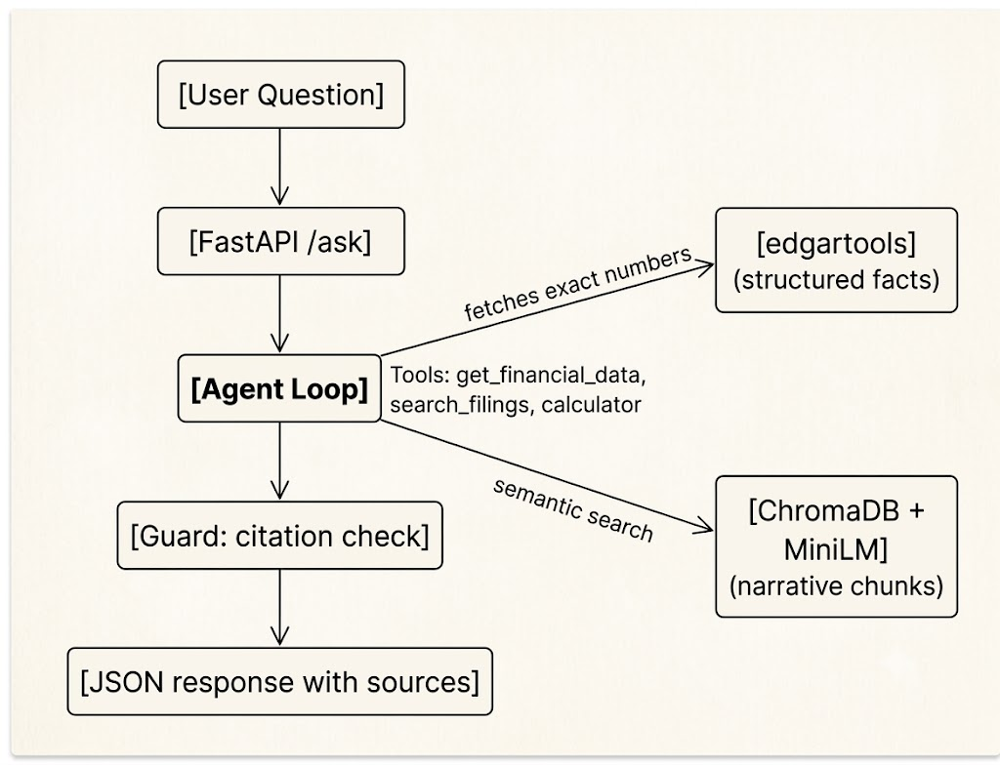

# CompanyScope

An AI financial analyst that reads SEC filings and XBRL financial statements to answer questions with exact, verified sources.  
No made-up numbers. No speculation. Every numeric fact and narrative quote is verified against primary filings.


## What it does

Ask a question about any public company (e.g., `"Calculate Apple's revenue growth from 2022 to 2023"` or `"What does Apple say about supply chain and cybersecurity risks?"`) and the system:

- **Fetches exact XBRL figures** directly from SEC EDGAR (`edgartools`) for numeric lookups (Revenue, Net Income, Operating Income, Assets, Liabilities, Equity, Cash Flows)
- **Searches narrative sections & inline tables** of 10-K and 10-Q filings using **Hybrid RAG** (Dense `all-MiniLM-L6-v2` embeddings + BM25 lexical search with Reciprocal Rank Fusion) and **RAPTOR-lite hierarchical section summaries**
- **Executes exact arithmetic** via an AST-validated `calculator` tool
- **Verifies every citation** via `src/guard.py`: narrative quotes are checked against retrieved filing chunks and numeric citations are validated against fetched XBRL values
- **Supports multi-turn conversations & on-demand multi-ticker ingestion** via the FastAPI backend and Streamlit Analyst Workspace

## Architecture



1. **Structured XBRL Pipeline (`src/tools.py`)**: Pulls authoritative 10-K financial figures directly from SEC EDGAR via `edgartools`.
2. **Hybrid RAG + RAPTOR-lite Ingestion (`src/ingest.py`, `src/embed.py`)**:
   - Extracts narrative sections (`Item 1`, `Item 1A`, `Item 7`, `Item 7A`, and 10-Q `Item 2`) while preserving compact inline financial/segment tables as Markdown.
   - Builds both granular leaf chunks and **RAPTOR-lite section overview nodes** (`chunk_level="summary"`) composed of verbatim lead sentences across section clusters.
   - Retrieves chunks using **Reciprocal Rank Fusion (RRF)** over ChromaDB dense vector search + `rank-bm25` lexical search.
3. **Multi-Provider Agent Loop (`src/agent.py`)**:
   - Supports OpenAI-compatible endpoints (`gpt-6-luna` via `OPENAI_URL` / `OPENAI_KEY`) as well as Groq (`llama-3.3-70b-versatile`) with automatic fallback, multi-turn history, tool execution traces, and optional **Langfuse** observability.
4. **Citation Guard (`src/guard.py`)**:
   - Validates every numeric and narrative citation before returning the response.

## Tech Stack

- **Backend**: Python 3.11+, FastAPI, Uvicorn, SlowAPI
- **LLM Providers**: OpenAI-compatible API (`gpt-6-luna`) & Groq (`llama-3.3-70b-versatile`)
- **Retrieval**: ChromaDB (dense vectors) + `sentence-transformers` (`all-MiniLM-L6-v2`) + `rank-bm25` (lexical BM25) + Reciprocal Rank Fusion
- **Financial Data**: `edgartools` + `BeautifulSoup4`
- **Verification & Observability**: `rapidfuzz` citation guard + `langfuse` tracing
- **Frontend**: Streamlit Analyst Dashboard (multi-turn chat, live tool trace inspector, on-demand SEC ingestion, XBRL financial charts)
- **DevOps & Quality**: Docker & Docker Compose, GitHub Actions CI, Pytest evaluation suite, Ruff, MyPy

## Quickstart

### 1. Clone and install dependencies
```bash
git clone https://github.com/iamqazolp/CompanyScope.git
cd company-scope
uv sync
```

### 2. Configure `.env`
Create a `.env` file in the project root:
```env
OPENAI_URL=https://api.shopaikey.com
OPENAI_KEY=your_openai_key_here
OPENAI_MODEL=gpt-6-luna
GROQ_API_KEY=gsk_your_groq_key_here
EDGAR_IDENTITY=your_email@example.com
DEFAULT_TICKER=AAPL
```

### 3. Ingest SEC filings & build the Hybrid + RAPTOR-lite index
```bash
python -m src.ingest
python -m src.embed
```

### 4. Start the FastAPI server and Streamlit Analyst Dashboard
```bash
uvicorn src.app:app --reload
```
In a second terminal:
```bash
streamlit run streamlit_app.py
```

Or run everything with **Docker Compose**:
```bash
docker compose up --build
```

## API Endpoints

- `GET /health` — Backend health, active LLM provider, and model name
- `GET /tickers` — Summary of indexed tickers, chunk counts, years, and sections in ChromaDB
- `POST /ingest` — Download 10-K/10-Q filings for any ticker and index them into ChromaDB on demand
- `GET /financials/{ticker}` — Multi-year structured 10-K XBRL metrics for charts and tables
- `POST /ask` — Ask a financial question (supports `question`, `ticker`, `history`, `provider`, `model`)

## Evaluation & CI

Run linting, type-checking, and the automated evaluation benchmark:
```bash
ruff check .
mypy src/ --ignore-missing-imports
pytest tests/test_eval.py -v --json-report --json-report-file=report.json
python scripts/check_thresholds.py report.json
```

---

Built by Dang Quan
