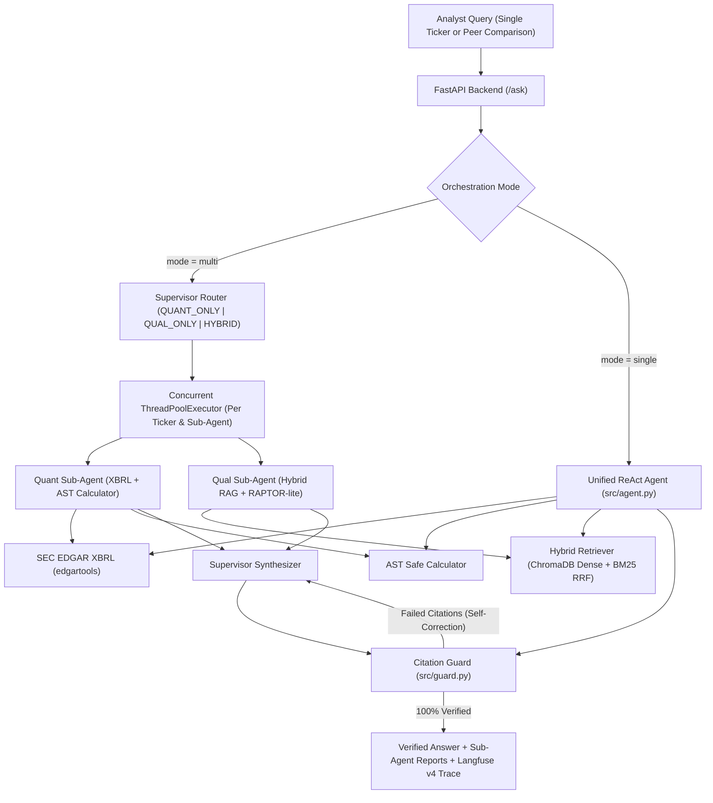

# CompanyScope

**Zero-Hallucination Multi-Agent Financial Analyst for SEC Filings & XBRL Data**

CompanyScope is an agentic financial research platform that reads primary SEC `10-K` and `10-Q` filings and authoritative XBRL financial statements to answer complex equity research questions with **100% verified citations**. Every numeric figure is cross-checked against structured SEC EDGAR XBRL facts, and every narrative claim is fuzzy-verified against primary filing text before reaching the user.


---

## Key Capabilities

- **Native Multi-Agent Supervisor (`src/multi_agent.py`)**
  - Classifies user queries into `QUANT_ONLY`, `QUAL_ONLY`, or `HYBRID` execution plans.
  - Dispatches specialized **Quantitative** (`get_financial_data` + AST `calculator`) and **Qualitative** (`search_filings` Hybrid RAG) sub-agents concurrently via `ThreadPoolExecutor`.
  - Supports **Multi-Company Peer Comparison** (e.g., comparing `AAPL` vs. `MSFT` margins and supply-chain risks in parallel).
- **Hybrid RAG + RAPTOR-Lite Filing Retrieval (`src/ingest.py`, `src/embed.py`, `src/tools.py`)**
  - Extracts narrative sections (`Item 1`, `Item 1A`, `Item 7`, `Item 7A`, and 10-Q `Item 2`) while preserving compact financial/segment HTML tables as inline Markdown.
  - Builds both granular leaf chunks (`chunk_level="leaf"`) and hierarchical **RAPTOR-lite section summary nodes** (`chunk_level="summary"`).
  - Combines **ChromaDB** dense vector embeddings (`all-MiniLM-L6-v2`) with **`rank-bm25`** lexical search via **Reciprocal Rank Fusion (RRF)**.
- **Authoritative XBRL Pipeline & Exact Arithmetic (`src/tools.py`)**
  - Pulls official `10-K` balance sheet, income statement, and cash flow statement metrics directly from SEC EDGAR via `edgartools`.
  - Performs deterministic growth, margin, and ratio calculations via an AST-validated `calculator` tool—never relying on LLM mental math.
- **Self-Correcting Citation Guard (`src/guard.py`)**
  - Validates every `[10-K YYYY, Section]` quote using `rapidfuzz` (`token_set_ratio` / `partial_ratio`) and every `[XBRL 10-K YYYY]` number against fetched XBRL values.
  - If any citation fails verification, the agent automatically enters a **self-correction retry loop** with exact failure feedback before returning an answer.
- **Langfuse v4 Observability & Cost Management (`src/config.py`, `scripts/manage_model_pricing.py`)**
  - Full OpenTelemetry hierarchical tracing across `agent`, `generation`, `retriever`, `tool`, and `guardrail` spans.
  - Built-in model pricing registry (`src/model_pricing.json`) with tiered token accounting (`input`, `input_cached_tokens`, `cache_write_tokens`, `output`) and an interactive CLI to sync custom models and backfill historical Langfuse traces.

---

## System Architecture



---

## Project Structure

```text
company-scope/
├── src/
│   ├── app.py                 # FastAPI server (/health, /tickers, /ingest, /financials, /ask)
│   ├── agent.py               # Single-agent tool-calling loop with Citation Guard retry
│   ├── multi_agent.py         # Multi-Agent Supervisor (concurrent Quant/Qual + peer comparison)
│   ├── tools.py               # XBRL lookup, Hybrid RAG (ChromaDB + BM25 RRF), AST calculator
│   ├── guard.py               # RapidFuzz narrative & XBRL numeric citation verifier
│   ├── ingest.py              # SEC EDGAR 10-K/10-Q parser, inline Markdown tables, RAPTOR-lite
│   ├── embed.py               # ChromaDB indexer with deterministic chunk IDs
│   ├── config.py              # Unified settings, Langfuse v4 helpers, and cost computation
│   ├── prompts.py             # Grounded financial analyst system prompts
│   └── model_pricing.json     # Per-1M token pricing registry (input, cached, cache write, output)
├── scripts/
│   ├── manage_model_pricing.py # CLI/interactive tool to update model rates & backfill Langfuse
│   ├── backfill_langfuse_costs.py
│   └── check_thresholds.py    # CI evaluation pass-rate gate (>= 90%)
├── tests/
│   └── test_eval.py           # End-to-end golden evaluation benchmark (15 test cases)
├── streamlit_app.py           # Streamlit Analyst Workspace UI
├── Dockerfile                 # Multi-service container image
├── docker-compose.yml         # FastAPI + Streamlit orchestration
└── Makefile                   # Developer workflow shortcuts
```

---

## Quickstart

### 1. Clone & Install Dependencies
```bash
git clone https://github.com/iamqazolp/CompanyScope.git
cd company-scope
uv sync
```

### 2. Configure Environment Variables (`.env`)
Create a `.env` file in the repository root:
```env
# Primary OpenAI-compatible LLM endpoint
OPENAI_URL=https://api.shopaikey.com
OPENAI_KEY=your_openai_api_key
OPENAI_MODEL=gpt-6-luna

# Fallback / alternative provider (Groq)
GROQ_API_KEY=gsk_your_groq_key

# SEC EDGAR identity (required by SEC fair-access policy)
EDGAR_IDENTITY=your_email@example.com
DEFAULT_TICKER=AAPL

# Optional: Langfuse v4 Observability
LANGFUSE_PUBLIC_KEY=pk-lf-...
LANGFUSE_SECRET_KEY=sk-lf-...
LANGFUSE_BASE_URL=https://us.cloud.langfuse.com
```

### 3. Ingest SEC Filings & Build the Hybrid Index
```bash
make ingest   # Downloads 10-K/10-Q filings and builds RAPTOR-lite + leaf chunks
make embed    # Indexes chunks into ChromaDB
```

### 4. Launch the Backend & Analyst Workspace
```bash
# Terminal 1 — FastAPI Backend (http://localhost:8000)
make run-api

# Terminal 2 — Streamlit Analyst Dashboard (http://localhost:8501)
make run-ui
```

Or run both services via **Docker Compose**:
```bash
docker compose up --build
```

---

## API Reference

| Method | Endpoint | Description |
| :--- | :--- | :--- |
| `GET` | `/health` | Active LLM provider, model, and service status |
| `GET` | `/tickers` | Indexed tickers, chunk counts, filing years, and sections in ChromaDB |
| `POST` | `/ingest` | On-demand SEC EDGAR download (`10-K`/`10-Q`) and ChromaDB indexing for any ticker |
| `GET` | `/financials/{ticker}` | Multi-year structured `10-K` XBRL financial metrics for charting |
| `POST` | `/ask` | Run a single-agent or multi-agent query across one or more tickers |

### Example `POST /ask` Request (Multi-Agent Peer Comparison)
```json
{
  "question": "Compare revenue growth and key supply chain risks between Apple and Microsoft.",
  "ticker": "AAPL",
  "tickers": ["AAPL", "MSFT"],
  "mode": "multi",
  "provider": "openai"
}
```

---

## Model Pricing & Langfuse Cost Backfill

CompanyScope includes a CLI and interactive wizard ([`scripts/manage_model_pricing.py`](scripts/manage_model_pricing.py)) to manage custom model token rates in [`src/model_pricing.json`](src/model_pricing.json), sync them to Langfuse, and backfill historical `GENERATION` observations via OpenTelemetry OTLP:

```bash
# Interactive wizard
make pricing

# Non-interactive CLI update + historical backfill
python -m scripts.manage_model_pricing \
  --model gpt-6-luna \
  --input 0.10 \
  --cached-input 0.01 \
  --cache-write 0.125 \
  --output 0.50 \
  --backfill

# List all configured models and pricing tiers
python -m scripts.manage_model_pricing --list
```

---

## Evaluation & Quality Checks

Run Ruff linting, MyPy static type checking, and the 15-case golden evaluation suite:

```bash
make lint
make eval
```

---

Built by **Dang Quan**
